# Disclaimer

Flashing firmware carries risks. Proceed with caution. The firmware provided here is intended for learning and discussion only. The author accepts no responsibility for any hardware damage, software damage, or data loss caused by flashing or using this firmware. Use it at your own risk.

# Tips for the Lenovo Y700 Gen 4

## 1. Force restarting and entering bootloader mode

In any device state—including a running operating system, a frozen operating system, or EDL mode—press and hold **Power + Volume Down** to force a restart. During the restart, switch to holding **Volume Up + Power** at the right moment (after the device powers off but before the screen lights up again) to enter bootloader mode instead of booting the operating system.

Open question: Does this key combination still work if XBL/ABL is corrupted or frozen?

## 2. Entering EDL mode

- From Android or recovery: `adb reboot edl`
- From bootloader (fastboot) or fastbootd: `fastboot oem edl`
- Connect an EDL engineering cable, then power on, restart, or force restart the tablet.

## 3. Recovering from failures to flash or boot a custom boot image

If `fastboot flash boot_a foo.img` or `fastboot boot bar.img` fails, where `foo.img` and `bar.img` are custom images, try the following:

First, use `fastboot flash` to restore the stock Android partitions from your backup. Restore every partition to which you previously flashed a custom image. For example, if you flashed custom images to `boot_a` and `dtbo_a` during development, restore those partitions. Then run `fastboot reboot recovery` and let recovery boot successfully into the Android kernel. Finally, run `adb reboot bootloader` to return to bootloader mode. You should then be able to flash a custom `boot.img` using `fastboot flash`. The reason this workaround works is currently unknown.

The error typically looks like this:

```bash
❯ fastboot boot ./Armbian-unofficial_26.11.0-trunk_Lenovo-y700-gen4_trixie_edge_7.2.11_gnome-abl_desktop.boot_sm8750-lenovo-elden.img
< waiting for any device >
Sending 'boot.img' (87540 KB)                      OKAY [  0.203s]
Booting                                            FAILED (remote: 'Failed to load/authenticate boot image: Load Error')
fastboot: error: Command failed
```

# Operating System Links

[Armbian](https://github.com/retro98boy/armbian-build)

[Batocera](https://github.com/retro98boy/batocera.linux)

[Armada](https://github.com/retro98boy/armada)

Known firmware limitations:

- microSD DMA is currently unavailable. The controller is restricted to PIO, resulting in slow reads and writes.
- The display is currently locked to 120 Hz.
- Coexistence of Android and Linux is not supported.

Peripherals not yet supported:

- Cameras
- Microphones
- Accelerometer, magnetometer, ambient light sensor, and other sensors

# Backing Up the Partitions

A full partition backup is strongly recommended: the UFS may contain device-specific calibration data. A backup also makes it easy to restore individual partitions at any point during experimentation.

Start with a fully working Android installation. The author used `ZUXOS_1.5.10.259`.

The backup procedure below uses the Windows application **GeekFlashTool (刷机匣)**.

Download: `https://syxz.lanzoue.com/b0mbywcli`, password: `bmxw`. Advanced Linux users can use alternatives such as `bkerler/edl`.

Make sure the Qualcomm EDL driver is installed on your Windows PC, then put the tablet into EDL mode.

Double-click `GeekFlashTool.exe` to launch the application.

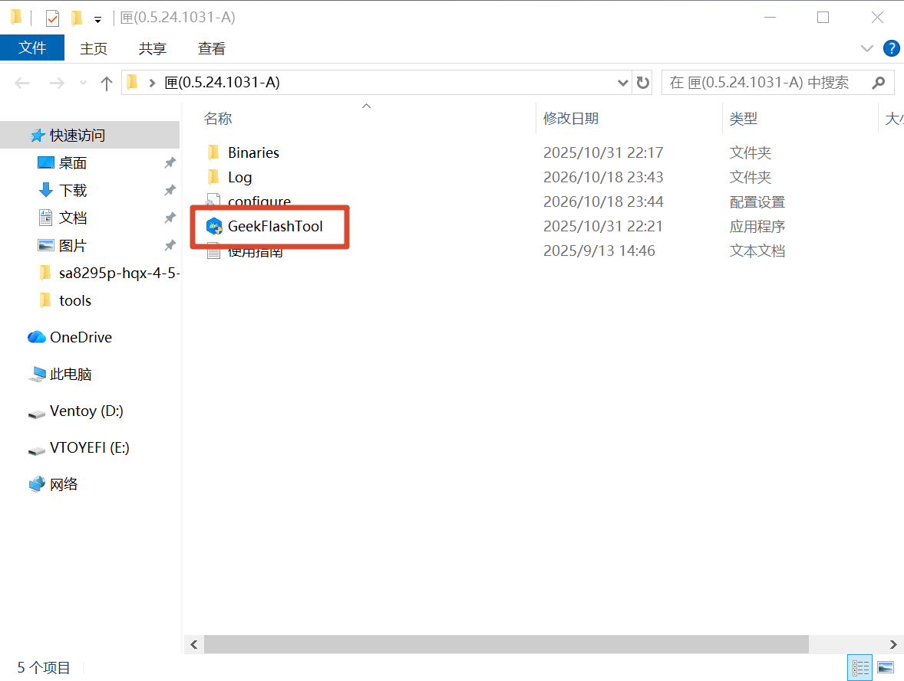

Click the area outlined in red to open the Qualcomm EDL flashing interface.

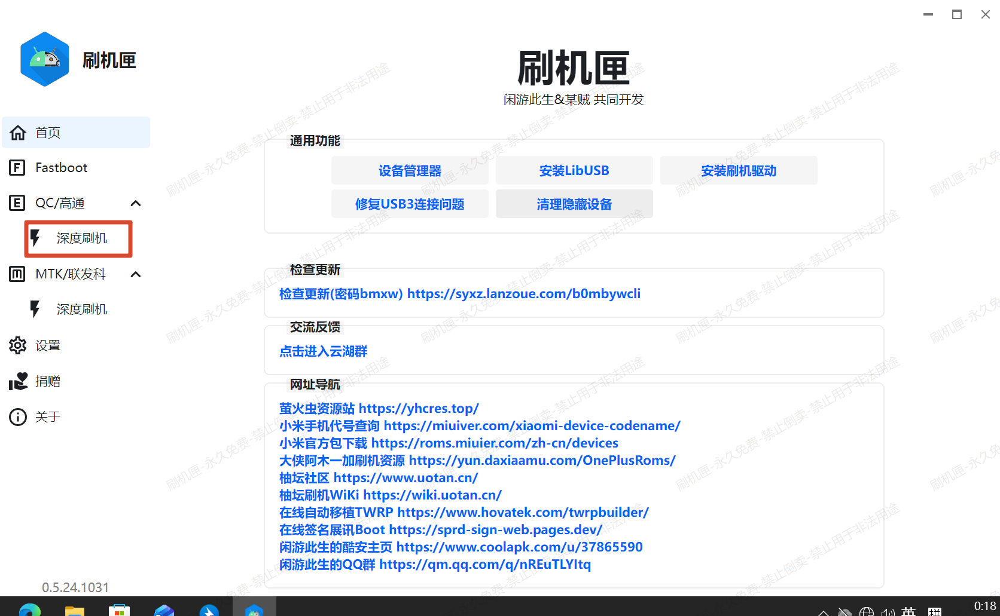

Click the area outlined in red to select a loader.


Select the loader file on your Windows PC, set the storage type to **UFS**, and confirm.

The loader is named `xbl_s_devprg_ns.melf` and can be found in Lenovo's EDL recovery firmware package.


Click the area outlined in red to read the device information, including the LUN configuration and partition tables.

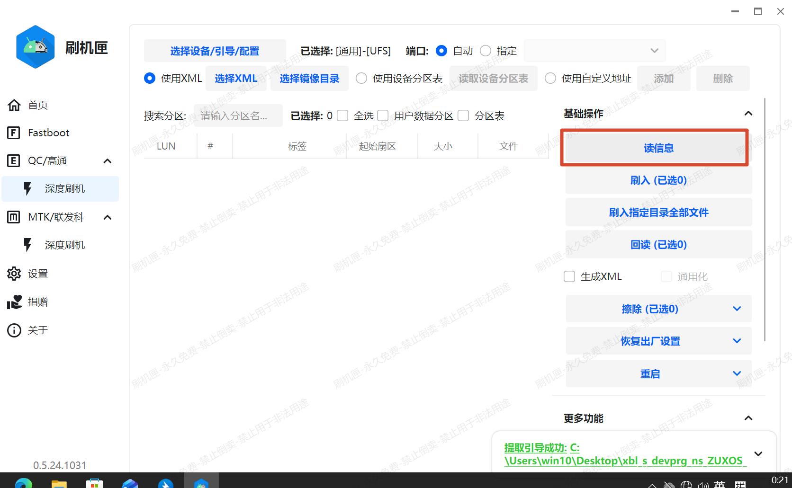

Once the partition tables have been read successfully, click the controls marked **1, 2, 3, and 4**, in that order. **Keep options 3 and 4 checked**; the author forgot to check them when taking the screenshot.

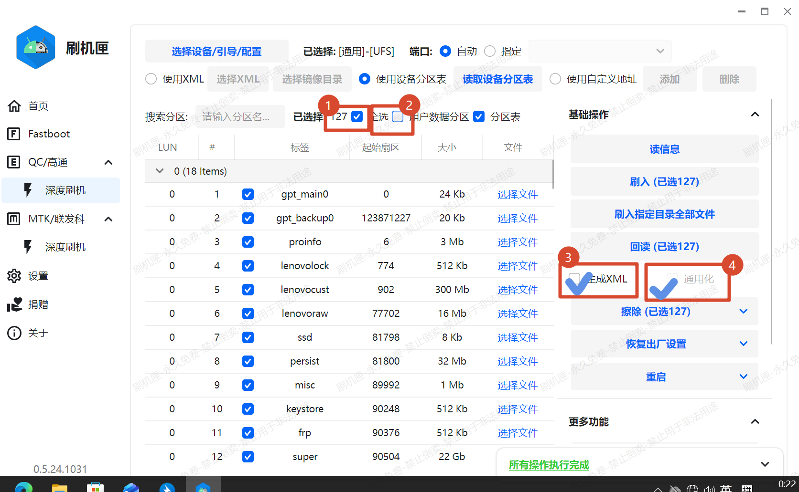

After these selections, all partitions should be selected except `metadata` and `userdata`, as shown below. These contain Android user data and can be very large, so backing them up is not recommended in this procedure.

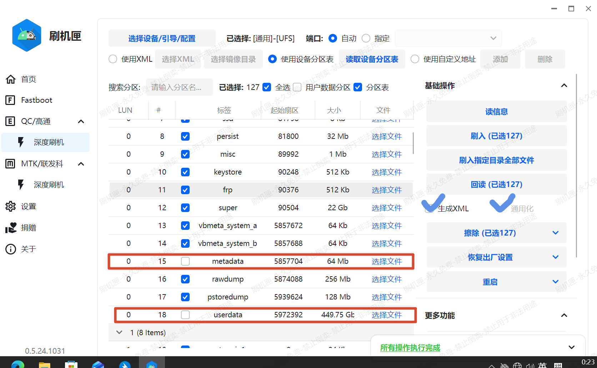

Click the area outlined in red to start reading back the selected partitions.

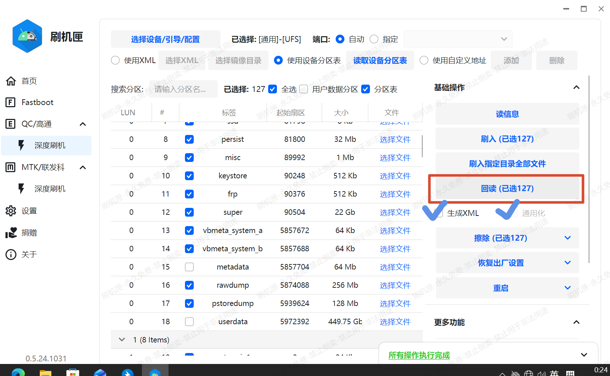

Choose a directory on your Windows PC for the backup. There is no need to create a separate subdirectory: GeekFlashTool automatically creates one inside the selected directory to store the partition images.

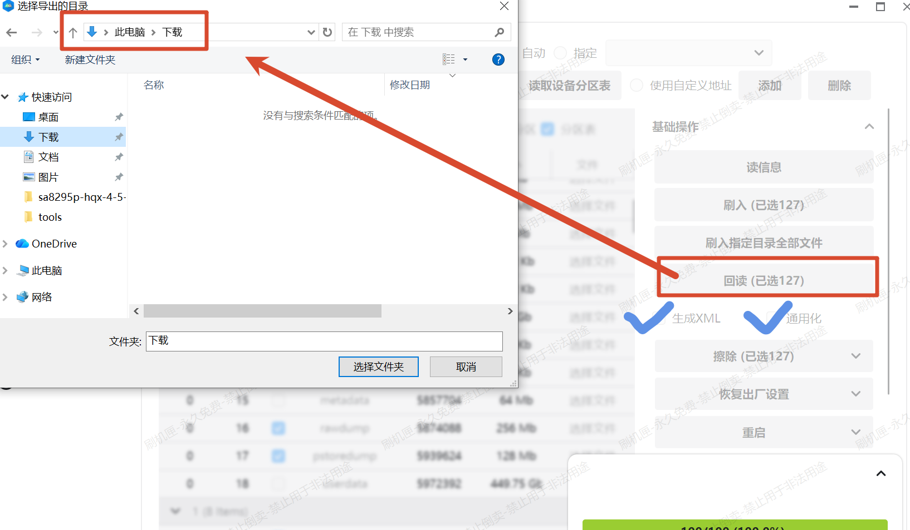

Wait for the readback to finish.

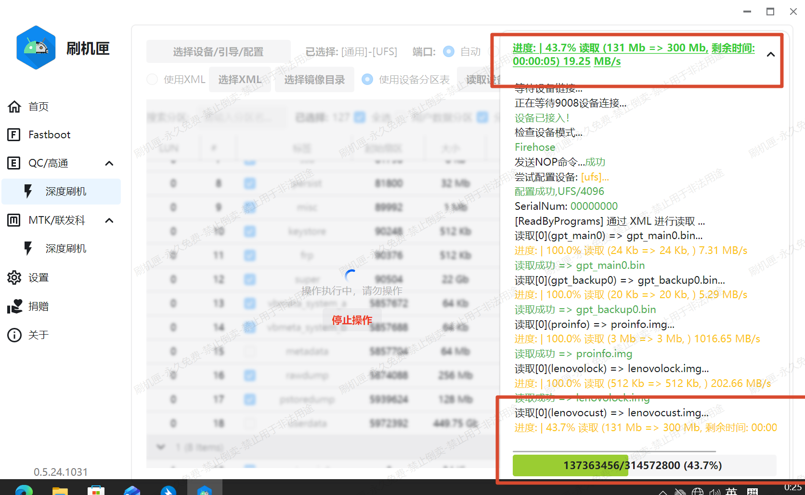

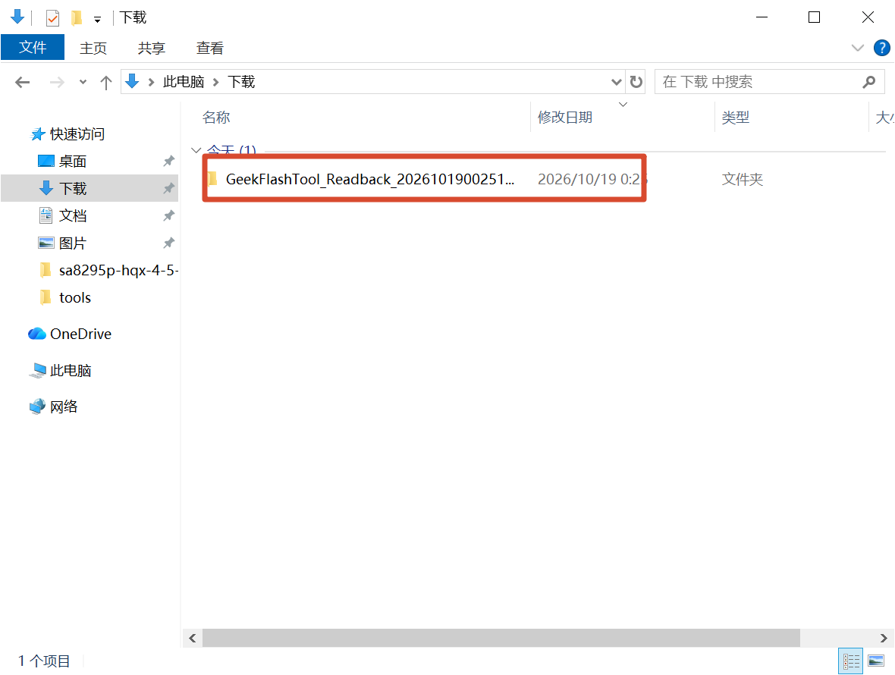

Once it finishes, you can restart the tablet using GeekFlashTool's reboot function.

# Installing Linux

First, follow a suitable guide to unlock the bootloader.

Note: In theory, this tablet can be flashed without unlocking the bootloader. Early Y700 Gen 4 firmware used the AOSP test key for AVB signing, so a `boot.img` signed with that key, together with an early ABL (from a version older than `ZUXOS_1.5.10.183`), can boot Project Aloha. This guide does not cover that approach.

## Flashing via EDL (Recommended: Simple and Fast)

This method requires the partition backup described in the preceding section.

### 1. Obtain a LUN0 GPT for Linux

Download `new-lun0-gpt.7z` from the [Releases page](https://github.com/retro98boy/qualcomm-devices/releases/tag/lenovo-y700-gen4). It contains a modified LUN0 GPT. Compared with the stock Android layout, it shrinks the Android `userdata` partition and adds partitions for Armbian, Batocera, and Armada.

The resulting partition sizes are shown below:

```bash
root@lenovo-y700-gen4:~# parted /dev/sda unit GiB print
Model: MICRON MT512GBGBB4U41 (scsi)
Disk /dev/sda: 473GiB
Sector size (logical/physical): 4096B/4096B
Partition Table: gpt
Disk Flags:

Number  Start    End      Size     File system  Name               Flags
 1      0.00GiB  0.00GiB  0.00GiB               proinfo
 2      0.00GiB  0.00GiB  0.00GiB               lenovolock
 3      0.00GiB  0.30GiB  0.29GiB  ext4         lenovocust
 4      0.30GiB  0.31GiB  0.02GiB               lenovoraw
 5      0.31GiB  0.31GiB  0.00GiB               ssd
 6      0.31GiB  0.34GiB  0.03GiB  ext4         persist
 7      0.34GiB  0.34GiB  0.00GiB               misc
 8      0.34GiB  0.34GiB  0.00GiB               keystore
 9      0.34GiB  0.35GiB  0.00GiB               frp
10      0.35GiB  22.3GiB  22.0GiB               super
11      22.3GiB  22.3GiB  0.00GiB               vbmeta_system_a
12      22.3GiB  22.3GiB  0.00GiB               vbmeta_system_b
13      22.3GiB  22.4GiB  0.06GiB               metadata
14      22.4GiB  22.7GiB  0.25GiB               rawdump
15      22.7GiB  22.8GiB  0.13GiB               pstoredump
16      22.8GiB  103GiB   80.0GiB               userdata
17      103GiB   103GiB   0.50GiB  fat32        armbian_efi        boot, esp
18      103GiB   167GiB   64.0GiB  ext4         armbian_rootfs
19      167GiB   183GiB   16.0GiB  fat32        batocera_boot      boot, esp
20      183GiB   311GiB   128GiB   ext4         batocera_userdata
21      311GiB   312GiB   1.00GiB  fat32        armada_efi         boot, esp
22      312GiB   316GiB   4.00GiB  ext4         armada_boot
23      316GiB   473GiB   156GiB   btrfs        armada_rootfs
```

The last partition, `armada_rootfs`, does not have a fixed size. On the author's 512 GB Y700 Gen 4, it occupies the remaining 156 GiB of LUN0.

If this layout does not suit your needs—for example, you want more space for a particular system or do not need every system—you can generate your own LUN0 GPT.

Download `make-lun0-gpt.py` and the stock Android GPT archive, `stock-android-lun0-gpt.7z`, from the [Releases page](https://github.com/retro98boy/qualcomm-devices/releases/tag/lenovo-y700-gen4). Extract the archive, then use the following example to generate a new layout:

```bash
~/workspace/qualcomm/lenovo-elden
❯ ls stock-android-lun0-gpt
gpt_backup0.bin  gpt_main0.bin  patch0.xml  rawprogram0.xml

~/workspace/qualcomm/lenovo-elden
❯ python3 make-lun0-gpt.py \
--source ./stock-android-lun0-gpt \
--output-dir ./new-lun0-gpt \
--userdata-size 80GiB \
--partition armbian_efi=512MiB:efi \
--partition armbian_rootfs=64GiB \
--partition batocera_boot=16GiB:efi \
--partition batocera_userdata=128GiB \
--partition armada_efi=1GiB:efi \
--partition armada_boot=4GiB \
--last armada_rootfs
Wrote /home/zhenlin/workspace/qualcomm/lenovo-elden/new-lun0-gpt; nominal LUN0 size: 123871232 sectors (507376566272 bytes)
  16 userdata                  5972392..26943911     (85899345920 bytes)
  17 armbian_efi              26943912..27074983     (536870912 bytes)
  18 armbian_rootfs           27074984..43852199     (68719476736 bytes)
  19 batocera_boot            43852200..48046503     (17179869184 bytes)
  20 batocera_userdata        48046504..81600935     (137438953472 bytes)
  21 armada_efi               81600936..81863079     (1073741824 bytes)
  22 armada_boot              81863080..82911655     (4294967296 bytes)
  23 armada_rootfs            82911656..123871226    (167770402816 bytes)
The final partition is resized by patch0.xml for the actual target LUN size.

~/workspace/qualcomm/lenovo-elden
❯ ls new-lun0-gpt
gpt_backup0.bin  gpt_main0.bin  patch0.xml  rawprogram0.xml
```

### 2. Flash via EDL

Replace the LUN0 GPT files in your partition backup directory with the newly generated files.

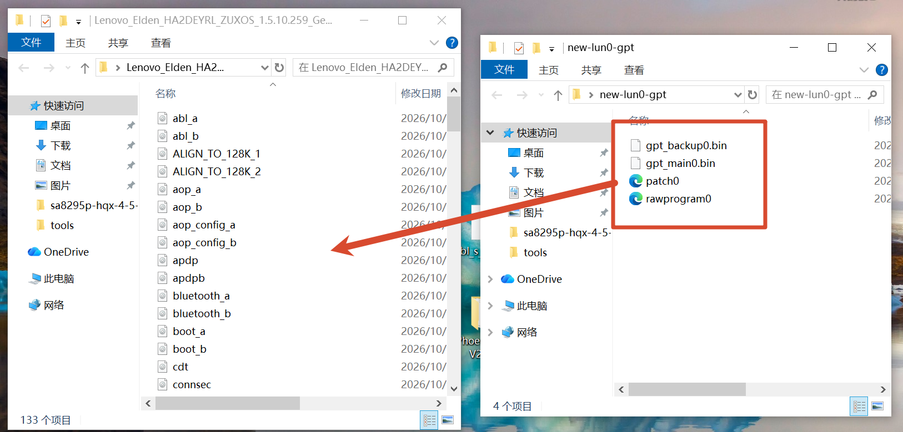

Make sure the Qualcomm EDL driver is installed on your Windows PC, then put the tablet into EDL mode.

Double-click `GeekFlashTool.exe` to launch the application.


Click the area outlined in red to open the Qualcomm EDL flashing interface.


Click the area outlined in red to select a loader.

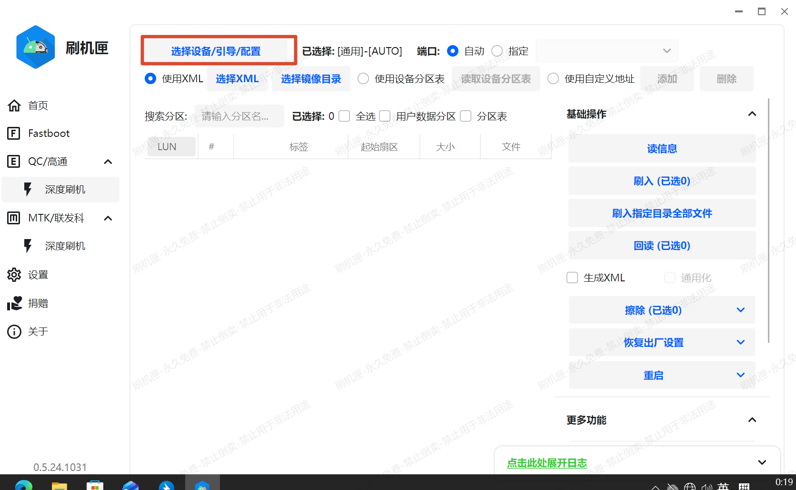

Select the loader file on your Windows PC, set the storage type to **UFS**, and confirm.

The loader is named `xbl_s_devprg_ns.melf` and can be found in Lenovo's EDL recovery firmware package.

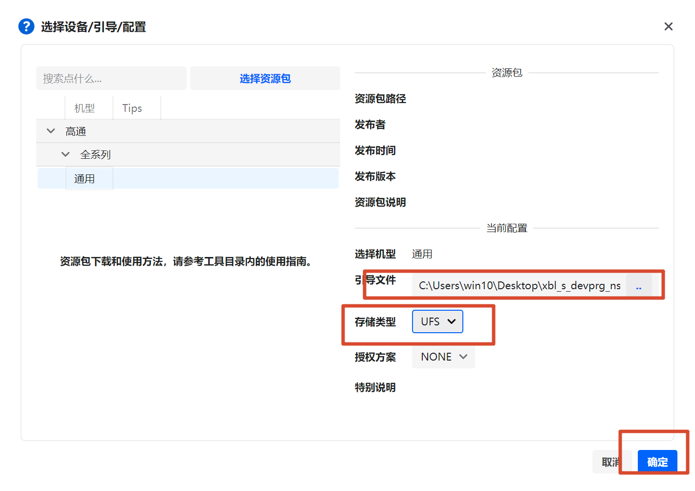

Click the area outlined in red to select your partition backup directory.

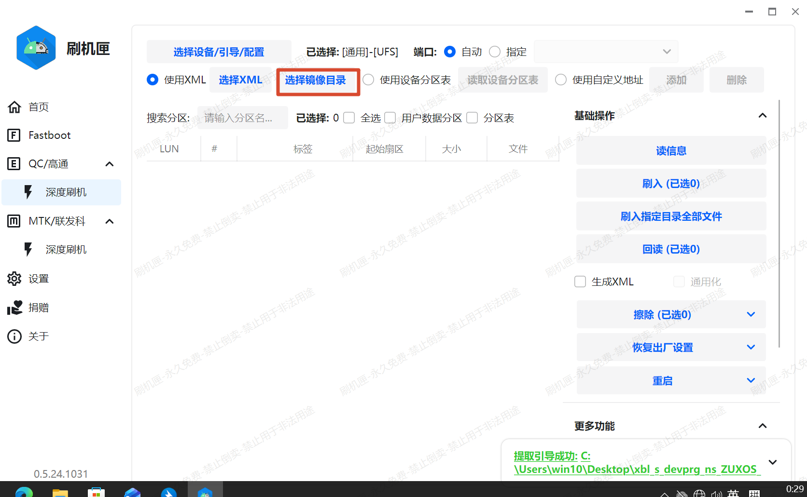

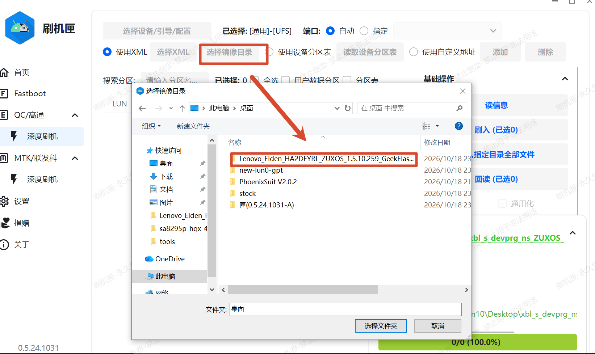

Clear the default selection so that no partitions are selected.

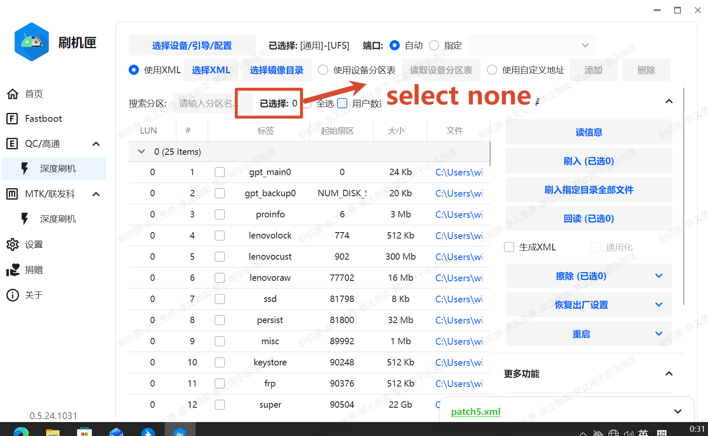

Select all partitions on LUN0 except `metadata` and `userdata`, as shown below.

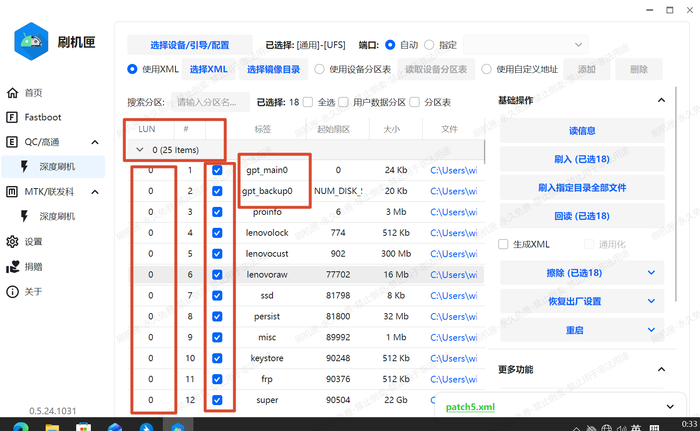

Select the Armbian, Batocera, and/or Armada partitions you want to install, and assign the corresponding partition images. The author selected all of them to install all three Linux systems.

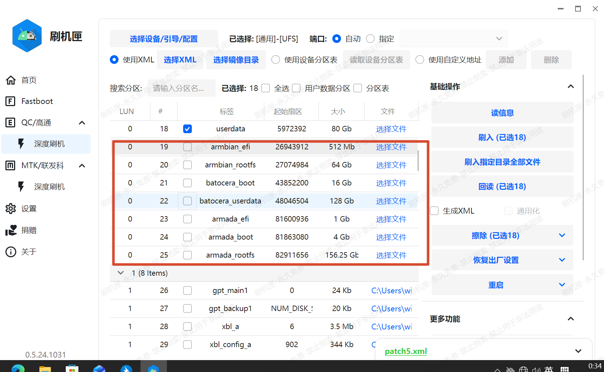

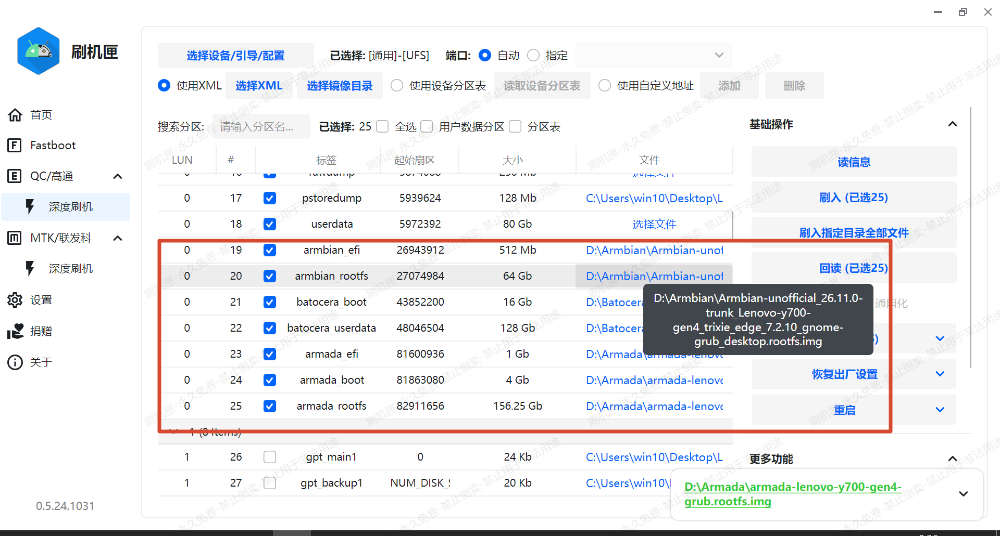

Select `boot_a` on LUN4 and assign Project Aloha's `boot.img` to it. Download the Project Aloha `boot.img` from the [Releases page](https://github.com/retro98boy/qualcomm-devices/releases/tag/lenovo-y700-gen4).

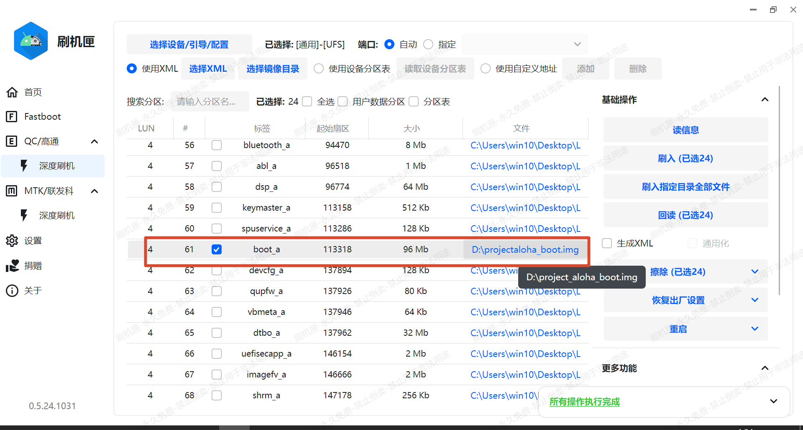

Click the flash button and wait for the operation to finish.

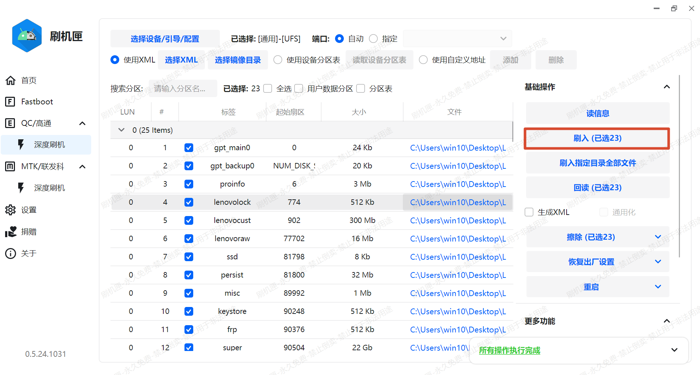

Once flashing is complete, you can restart the tablet using GeekFlashTool's reboot function.

## Installing via microSD (Flexible, but More Involved)

### 1. Flash Project Aloha UEFI FD

Download the Project Aloha image from the [Releases page](https://github.com/retro98boy/qualcomm-devices/releases/tag/lenovo-y700-gen4), then flash it with:

```bash
fastboot flash boot_a path-to-project-aloha.img && fastboot reboot
```

If flashing fails, see the earlier section on recovering from failures to flash or boot a custom boot image.

The current Project Aloha port can discover and run EFI applications from UFS and microSD cards. USB flash drives are not yet supported.

### 2. Boot a system from microSD

Among the provided Armbian, Batocera, and Armada images, the `.img` disk images are intended for microSD cards. Write one to a microSD card using a disk imaging tool, insert the card into the tablet, and power it on. Project Aloha will scan the card's EFI partition, launch GRUB, and boot the kernel.

If you only want to run the system from microSD, you can ignore the separate `.xxx.img` partition images intended for UFS and skip the remaining instructions.

### 3. Install Linux on UFS

Flash Project Aloha and boot Armbian from microSD as described above. In Armbian, use a tool such as `parted` or `cfdisk` to repartition the storage.

The tablet's UFS is provisioned into multiple LUNs. LUN0 is the largest and contains Android's `userdata` partition. In this setup, Armbian exposes LUN0 as `/dev/sda`. Use `cfdisk` on `/dev/sda` to delete the trailing `userdata` partition (**this destroys Android user data**), then recreate a smaller `userdata` partition, for example 64 GB. This leaves only 64 GB of user storage for Android.

Allocate the remaining space on `/dev/sda` (LUN0) as desired. For example, create:

- A 512 MiB partition with the GPT partition name `armbian_efi`
- A 64 GiB partition named `armbian_rootfs`
- A 16 GiB partition named `batocera_boot`
- A 128 GiB partition named `batocera_userdata`

This allows both Armbian and Batocera to be installed on UFS.

Note: Names such as `boot_a`, `userdata`, and `abl_a`, used when flashing in EDL or fastboot mode, are **GPT partition names**. In Armbian, you can assign a name with a command such as:

```bash
sudo parted /dev/sda name 18 armbian_rootfs
```

If you recreate the `userdata` partition, make sure its GPT partition name is `userdata`: Android depends on that name.

After partitioning, use `dd` to write `armbian-xxxx.efi.img`, `armbian-xxxx.rootfs.img`, `batocera-xxxx.boot.img`, and `batocera-xxxx.userdata.img` to their respective partitions, then reboot.

# Related Links

[Pengyu Luo — https://lore.kernel.org](https://lore.kernel.org/all/?q=f:mitltlatltl@gmail.com+AND+s:PATCH+AND+NOT+s:Re:)

[GEEKiDoS/linux](https://github.com/GEEKiDoS/linux)

[h0cheung/tb322fc-linux-kernel](https://github.com/h0cheung/tb322fc-linux-kernel)

[xiaquwan1001/lenovo-legion-y700-gen4-tb322fc-elden-linux](https://github.com/xiaquwan1001/lenovo-legion-y700-gen4-tb322fc-elden-linux)
